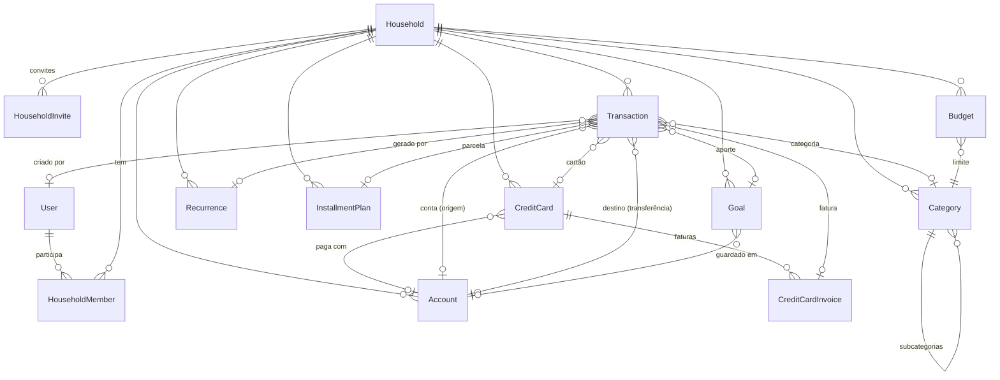

# Banco de dados

PostgreSQL (hospedado no **Supabase**), acessado pela API via **Prisma**.
Fonte da verdade: [`api/prisma/schema.prisma`](../api/prisma/schema.prisma) + migrações em `api/prisma/migrations/`.

## Princípios

1. **Tudo pertence a um Grupo** (`Household`). Usuários entram em grupos como membros; contas, cartões, categorias e lançamentos são do grupo. Uso individual = um grupo com um membro só.
2. **Dinheiro em centavos** (`Int`), sempre positivo. O sentido (entrada/saída) vem do `type` do lançamento.
3. **Um lançamento por movimentação.** Transferência é *um* registro com origem e destino, não dois.
4. **Integridade no banco**, não só na API: `CHECK`s e *triggers* barram dados inconsistentes mesmo se alguém editar pelo painel do Supabase.
5. **Arquivar em vez de excluir** contas, cartões, categorias e metas (`archivedAt`), preservando o histórico.

## Diagrama



## Tabelas

| Tabela | O que guarda | Campos importantes |
|---|---|---|
| `User` | login | `email` (único), `passwordHash` |
| `Household` | grupo financeiro (casa, casal, pessoal) | `name`, `currency` |
| `HouseholdMember` | quem participa de qual grupo | `role`: `OWNER` / `MEMBER` |
| `HouseholdInvite` | convite por e-mail | `token` (único), `expiresAt`, `acceptedAt` |
| `Account` | corrente, poupança, carteira, investimento | `initialBalanceCents`, `includeInTotals`, `ownerId` (null = conjunta) |
| `CreditCard` | cartão | `limitCents`, `closingDay`, `dueDay`, `paymentAccountId`, `holderId` |
| `CreditCardInvoice` | fatura mensal | `referenceMonth` (dia 1 do mês do vencimento), `closingDate`, `dueDate`, `status` |
| `Category` | categorias com 1 nível de subcategoria | `type` (`INCOME`/`EXPENSE`), `parentId` |
| `Transaction` | toda movimentação | ver abaixo |
| `InstallmentPlan` | compra parcelada | `totalAmountCents`, `installmentCount`, `firstDate` |
| `Recurrence` | modelo de lançamento fixo, em conta **ou no cartão** | `frequency`, `interval`, `nextDate`, `amountIsEstimate`, `autoMarkPaid` |
| `Budget` | limite mensal por categoria | `month` (dia 1), `limitCents` |
| `Goal` | meta de economia | `targetCents`, `initialCents`, `targetDate`, `accountId` |

### Lançamentos (`Transaction`)

| `type` | Significado | Campos obrigatórios | Entra em receitas/despesas? |
|---|---|---|---|
| `INCOME` | entrada | `accountId` **ou** (`creditCardId` + `invoiceId`, para estorno) | sim (receita) |
| `EXPENSE` | saída | `accountId` **ou** (`creditCardId` + `invoiceId`) | sim (despesa) |
| `TRANSFER` | conta → conta | `accountId` (origem) + `destinationAccountId` | não |
| `INVOICE_PAYMENT` | paga fatura | `accountId` + `invoiceId` | não (as compras já contaram) |

- `status`: `PENDING` (previsto / a pagar) ou `PAID` (efetivado). Contas a pagar são despesas `PENDING` com `date` = vencimento.
- Compras no cartão contam como despesa **na data da compra**; o dinheiro sai da conta só no `INVOICE_PAYMENT`.
- Parcelas: cada parcela é um lançamento com `installmentPlanId` + `installmentNumber` (único por plano).
- Recorrências: veja a seção abaixo.
- `createdById`: quem registrou (útil no uso compartilhado).

## Recorrências: previsto × realizado

Uma recorrência (aluguel, salário, energia, assinatura) pode sair de uma **conta** ou de um **cartão de crédito**.

**1. Geração.** A API cria as próximas ocorrências (ex.: 3 meses à frente) como lançamentos `PENDING`:

| Campo | Valor na geração |
|---|---|
| `amountCents` e `expectedAmountCents` | valor previsto da recorrência |
| `date` e `occurrenceDate` | data programada |
| `invoiceId` (se cartão) | fatura em que a data programada cai |

Se a recorrência tiver `autoMarkPaid` (valor fixo, débito automático), a ocorrência já nasce `PAID`.

**2. No dia: confirmação.** O app lista os lançamentos `PENDING` com `date <= hoje` ("previstos para hoje / atrasados"). Ao confirmar, o usuário pode:

- corrigir o **valor** → muda `amountCents`; `expectedAmountCents` fica com a previsão original;
- corrigir a **data** → muda `date` (no cartão, a fatura é recalculada); `occurrenceDate` continua com a data programada, o que mantém a sequência da recorrência intacta;
- opcionalmente, **usar o valor real como nova previsão** → a API atualiza `Recurrence.amountCents` e as ocorrências futuras ainda pendentes.

Status passa para `PAID`.

**3. Outras ações.** *Pular* uma ocorrência = excluí-la (como `nextDate` já avançou, ela não é recriada). *Encerrar* a recorrência = `endDate` ou `active = false`; as ocorrências pendentes futuras são removidas.

| Flag da recorrência | Uso típico | Comportamento |
|---|---|---|
| `amountIsEstimate = true` | energia, água, cartão de consumo variável | gera `PENDING`; ao confirmar, o app pede o valor real |
| `autoMarkPaid = true` | Netflix, aluguel em débito automático | gera já `PAID` |
| nenhuma | salário, aluguel por boleto | gera `PENDING`; confirmação com o valor sugerido |

`amountIsEstimate` e `autoMarkPaid` não podem estar ligados juntos (estimativa precisa de confirmação).

Efeito nos saldos:
- **Conta:** `balanceCents` só conta o que foi confirmado; `projectedBalanceCents` inclui as previsões.
- **Fatura:** `totalCents` só conta compras confirmadas; `projectedTotalCents` inclui as recorrências ainda previstas.
- **Comparação:** a view `recurrence_variance` mostra previsto × pago de cada ocorrência confirmada.

## Regras garantidas pelo banco

| Regra | Onde |
|---|---|
| Valores > 0; dias do cartão entre 1 e 31; meses de referência no dia 1 | `CHECK` |
| Forma do lançamento conforme o tipo (tabela acima) | `CHECK tx_shape_by_type` |
| Recorrência e parcelamento com exatamente uma origem (conta ou cartão) | `CHECK` |
| Conta, cartão, fatura, categoria, parcelamento, recorrência e meta do mesmo grupo do lançamento | trigger `check_transaction_refs` |
| Categoria do mesmo tipo do lançamento; fatura do mesmo cartão | trigger `check_transaction_refs` |
| Subcategoria só 1 nível, mesmo grupo e tipo do pai | trigger `check_category_parent` |
| Nome de categoria único por grupo/tipo/nível, ignorando maiúsculas | índice único |
| Um convite pendente por e-mail por grupo | índice único parcial |
| Ocorrência de recorrência sempre com data programada; mesma ocorrência não gerada duas vezes | `CHECK` + índice único `(recurrenceId, occurrenceDate)` |
| Recorrência de valor estimado não pode ser gerada já como paga | `CHECK` |

Teste automatizado dessas regras: [`api/prisma/tests/integridade.sql`](../api/prisma/tests/integridade.sql) (roda numa transação e desfaz tudo).

```bash
psql "$DIRECT_URL" -f api/prisma/tests/integridade.sql
```

## Views

| View | Para quê |
|---|---|
| `account_balances` | `balanceCents` (só efetivados) e `projectedBalanceCents` (inclui pendentes) de cada conta |
| `invoice_totals` | `totalCents` (compras confirmadas − estornos), `projectedTotalCents` (inclui previstas) e `paidCents` de cada fatura |
| `recurrence_variance` | previsto × realizado de cada ocorrência de recorrência confirmada |

## Configurando o Supabase

1. Crie um projeto em [supabase.com](https://supabase.com) (região **South America (São Paulo)**). Guarde a senha do banco.
2. Em **Project Settings → Database → Connection string**, copie:
   - **Transaction pooler** (porta `6543`) → `DATABASE_URL`, acrescentando `?pgbouncer=true` no final
   - **Session pooler** ou **Direct connection** (porta `5432`) → `DIRECT_URL`
3. Coloque as duas em `api/.env` (local) e nas variáveis de ambiente do servidor onde a API roda.
4. Crie as tabelas:
   ```bash
   npm run db:deploy
   ```
5. Confira em **Table Editor** no painel do Supabase.

> **Segurança:** o app acessa o banco só pela API (usuário `postgres` via Prisma). A API pública do Supabase (PostgREST) não é usada. Como as tabelas ficam no schema `public`, ative **RLS** em todas sem criar políticas: assim a chave pública do Supabase não lê nada, e a API (que conecta direto no Postgres) continua funcionando. Há um comando pronto em [`api/prisma/supabase-rls.sql`](../api/prisma/supabase-rls.sql), para rodar no **SQL Editor** depois das migrações.
