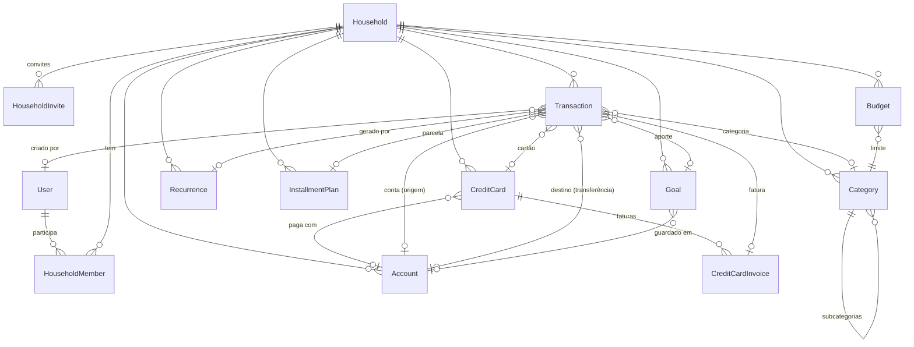

# Banco de dados

PostgreSQL (hospedado no **Supabase**), acessado pela API via **Prisma**.
Fonte da verdade: [`api/prisma/schema.prisma`](../api/prisma/schema.prisma) + migrações em `api/prisma/migrations/`.

## Princípios

1. **Tudo pertence a um Grupo** (`Household`). Usuários entram em grupos como membros; contas, cartões, categorias e lançamentos são do grupo. Uso individual = um grupo com um membro só.
2. **Dinheiro em centavos** (`Int`), sempre positivo. O sentido (entrada/saída) vem do `type` do lançamento.
3. **Um lançamento por movimentação.** Transferência é *um* registro com origem e destino, não dois.
4. **Integridade no banco**, não só na API: `CHECK`s e *triggers* barram dados inconsistentes mesmo se alguém editar pelo painel do Supabase.
5. **Arquivar em vez de excluir** contas, cartões, categorias e metas (`archivedAt`), preservando o histórico.

## Diagrama



## Tabelas

| Tabela | O que guarda | Campos importantes |
|---|---|---|
| `User` | login | `email` (único), `passwordHash` |
| `Household` | grupo financeiro (casa, casal, pessoal) | `name`, `currency` |
| `HouseholdMember` | quem participa de qual grupo | `role`: `OWNER` / `MEMBER`, `notifyDueItems` |
| `HouseholdInvite` | convite por e-mail | `token` (único), `expiresAt`, `acceptedAt` |
| `Account` | corrente, poupança, carteira, investimento | `initialBalanceCents`, `includeInTotals`, `ownerId` (null = conjunta) |
| `CreditCard` | cartão | `limitCents`, `closingDay`, `dueDay`, `paymentAccountId`, `holderId` |
| `CreditCardInvoice` | fatura mensal | `referenceMonth` (dia 1 do mês do vencimento), `closingDate`, `dueDate`, `status` |
| `Category` | categorias com 1 nível de subcategoria | `type` (`INCOME`/`EXPENSE`), `parentId` |
| `Transaction` | toda movimentação | ver abaixo |
| `InstallmentPlan` | compra parcelada | `totalAmountCents`, `installmentCount`, `firstDate` |
| `Recurrence` | modelo de lançamento fixo, em conta **ou no cartão** | `frequency`, `interval`, `nextDate`, `amountIsEstimate`, `autoMarkPaid` |
| `Budget` | limite mensal de gastos do dia a dia por categoria principal | `month` (dia 1), `limitCents` |
| `MonthPlan` | planejamento do mês | `month` (dia 1), `savingsGoalCents` (quanto quer guardar) |
| `Goal` | meta de economia | `targetCents`, `initialCents`, `targetDate`, `accountId` |
| `Loan` | empréstimo que o usuário pegou | `principalCents`, `interestType`, `monthlyRate`, `installmentCount`, `firstDueDate`, `status` |
| `PushSubscription` | aparelho que recebe aviso (Web Push) | `endpoint` (único), `p256dh`, `auth`, `failureCount` |
| `NotificationSettings` | preferências de aviso do usuário | `dueItemsEnabled`, `includeOverdue`, `sendHour`, `timezone` |
| `NotificationLog` | avisos enviados | único por `(userId, kind, referenceDate)` |

### Lançamentos (`Transaction`)

| `type` | Significado | Campos obrigatórios | Entra em receitas/despesas? |
|---|---|---|---|
| `INCOME` | entrada | `accountId` **ou** (`creditCardId` + `invoiceId`, para estorno) | sim (receita) |
| `EXPENSE` | saída | `accountId` **ou** (`creditCardId` + `invoiceId`) | sim (despesa) |
| `TRANSFER` | conta → conta | `accountId` (origem) + `destinationAccountId` | não |
| `INVOICE_PAYMENT` | paga fatura | `accountId` + `invoiceId` | não (as compras já contaram) |
| `LOAN_RECEIPT` | dinheiro do empréstimo entrando na conta | `accountId` + `loanId` | não (é dívida, não receita) |
| `LOAN_PAYMENT` | pagamento de empréstimo | `accountId` + `loanId`; divisão em `loanPrincipalCents` + `loanInterestCents` | **sim, a parcela inteira**, como despesa na categoria "Empréstimos" do resumo |

- `status`: `PENDING` (previsto / a pagar) ou `PAID` (efetivado). Contas a pagar são despesas `PENDING` com `date` = vencimento.
- Compras no cartão contam como despesa **na data da compra**; o dinheiro sai da conta só no `INVOICE_PAYMENT`.
- Parcelas: cada parcela é um lançamento com `installmentPlanId` + `installmentNumber` (único por plano).
- Recorrências: veja a seção abaixo.
- `createdById`: quem registrou (útil no uso compartilhado).

## Recorrências: previsto × realizado

Uma recorrência (aluguel, salário, energia, assinatura) pode sair de uma **conta** ou de um **cartão de crédito**.

**1. Geração.** A API cria as próximas ocorrências (ex.: 3 meses à frente) como lançamentos `PENDING`:

| Campo | Valor na geração |
|---|---|
| `amountCents` e `expectedAmountCents` | valor previsto da recorrência |
| `date` e `occurrenceDate` | data programada |
| `invoiceId` (se cartão) | fatura em que a data programada cai |

Se a recorrência tiver `autoMarkPaid` (valor fixo, débito automático), a ocorrência já nasce `PAID`.

**2. No dia: confirmação.** O app lista os lançamentos `PENDING` com `date <= hoje` ("previstos para hoje / atrasados"). Ao confirmar, o usuário pode:

- corrigir o **valor** → muda `amountCents`; `expectedAmountCents` fica com a previsão original;
- corrigir a **data** → muda `date` (no cartão, a fatura é recalculada); `occurrenceDate` continua com a data programada, o que mantém a sequência da recorrência intacta;
- opcionalmente, **usar o valor real como nova previsão** → a API atualiza `Recurrence.amountCents` e as ocorrências futuras ainda pendentes Essa opção vem **desmarcada** por padrão, em todos os tipos de recorrência.

Status passa para `PAID`.

**3. Outras ações.** *Pular* uma ocorrência = excluí-la (como `nextDate` já avançou, ela não é recriada). *Encerrar* a recorrência = `endDate` ou `active = false`; as ocorrências pendentes futuras são removidas.

| Flag da recorrência | Uso típico | Comportamento |
|---|---|---|
| `amountIsEstimate = true` | energia, água, cartão de consumo variável | gera `PENDING`; ao confirmar, o app pede o valor real |
| `autoMarkPaid = true` | Netflix, aluguel em débito automático | gera já `PAID` |
| nenhuma | salário, aluguel por boleto | gera `PENDING`; confirmação com o valor sugerido |

`amountIsEstimate` e `autoMarkPaid` não podem estar ligados juntos (estimativa precisa de confirmação).

Efeito nos saldos:
- **Conta:** `balanceCents` só conta o que foi confirmado; `projectedBalanceCents` inclui as previsões.
- **Fatura:** `totalCents` só conta compras confirmadas; `projectedTotalCents` inclui as recorrências ainda previstas.
- **Comparação:** a view `recurrence_variance` mostra previsto × pago de cada ocorrência confirmada.

## Planejamento do mês: quanto posso gastar

Tela **Planejar** (padrão: mês seguinte). O cálculo usa o **regime de caixa**, ou seja, quando o dinheiro sai da conta:

- **Contas:** pela data do lançamento.
- **Cartão:** pelo **vencimento da fatura**. Uma compra feita em novembro numa fatura que vence em dezembro pesa no planejamento de dezembro.

Cada saída do mês é classificada como:

| Classe | O que entra |
|---|---|
| **Compromisso** | ocorrências de recorrência (contas fixas), parcelas, parcelas de empréstimo e previsões cadastradas (lançamentos `PENDING` avulsos, ex.: IPVA) |
| **Gasto do dia a dia** | compras avulsas (consomem o disponível conforme acontecem) |

```
Disponível para gastar = receitas previstas − compromissos − quanto quero guardar (MonthPlan.savingsGoalCents)
Resta                  = disponível − gastos do dia a dia já feitos
Por dia                = resta ÷ dias que faltam no mês (mês futuro: o mês inteiro)
```

- A sobra do mês anterior **não** entra no disponível; fica como reserva nas contas.
- **Limites por categoria** (`Budget`) dividem o disponível entre as categorias principais. Os gastos das subcategorias somam na principal. Só os gastos do dia a dia contam nesses limites, porque os compromissos já foram descontados.
- "Copiar do mês anterior" copia os limites e a meta de guardar.
- Estorno no cartão reduz o gasto do dia a dia.

Cálculo em [`api/src/lib/plan.ts`](../api/src/lib/plan.ts), com testes em `api/test/plan.test.ts`. Rotas: `GET /api/plan?month=`, `PUT /api/plan/:month` (meta de guardar), `PUT /api/plan/:month/orcamentos`, `POST /api/plan/:month/copiar-anterior`.

## Empréstimos

Aba para os empréstimos que **você pegou** (banco, consignado, financiamento, parente). Você lança o valor emprestado; o app gera as parcelas, registra os pagamentos e mostra o **saldo devedor** sempre atualizado.

### Tipo de juros (escolhido por empréstimo)

| `interestType` | Uso típico | Como o saldo é calculado |
|---|---|---|
| `NONE` | dinheiro de parente/amigo | saldo = valor emprestado − soma dos pagamentos |
| `PRICE` | banco, consignado, financiamento | parcelas fixas (Tabela Price) com `monthlyRate` e `installmentCount`; cada parcela = juros do mês sobre o saldo + amortização |
| `MONTHLY_ON_BALANCE` | cheque especial, acordo com juros, empréstimo sem parcelas fixas | juros compostos mensais sobre o saldo, pró-rata por dia desde o último pagamento; pagamentos livres |

`monthlyRate` é a taxa mensal como fração (1,99% a.m. = `0.0199`).

### Fluxo

1. **Cadastro.** Informe nome, credor, valor, tipo de juros, taxa, nº de parcelas e 1º vencimento.
   - Se o dinheiro entrou numa conta (`receivedAccountId`), é criado um `LOAN_RECEIPT`, que aumenta o saldo da conta sem contar como receita.
   - Se o empréstimo tiver plano de parcelas, elas são criadas como `LOAN_PAYMENT` `PENDING`, com `loanInstallmentNumber`, valor previsto (`expectedAmountCents`) e divisão prevista entre juros e amortização.
2. **No dia.** A parcela aparece no **aviso do celular** e na lista "para confirmar", como as recorrências. Ao confirmar, você pode corrigir valor e data; a API recalcula a divisão entre juros e amortização.
3. **Pagamento avulso ou antecipado.** É um `LOAN_PAYMENT` sem número de parcela. Na Price, a antecipação amortiza 100%. Depois, a API recalcula as parcelas restantes com o novo saldo (parcela menor, mesmo prazo).
4. **Quitação.** Quando o saldo devedor chega a zero, o empréstimo vai para `PAID_OFF` com `paidOffAt`, e as parcelas pendentes que sobraram são removidas.

### Saldo devedor

A view `loan_balances` mostra, por empréstimo:

| Coluna | Significado |
|---|---|
| `principalOutstandingCents` | principal ainda devido (valor − amortizações confirmadas) |
| `accruedInterestCents` | juros acumulados desde o último pagamento até hoje (zero se sem juros) |
| `totalPaidCents` / `interestPaidCents` | total pago e quanto disso foi juros |
| `paidInstallments` / `pendingInstallments` / `pendingAmountCents` | parcelas pagas, a pagar e quanto falta pagar pelo plano |
| `nextDueDate` / `lastPaymentDate` | próximo vencimento e último pagamento |

**Saldo devedor hoje** = `principalOutstandingCents` + `accruedInterestCents`. É o valor aproximado para quitar hoje; o valor exato de quitação é informado pelo credor.

### Relatório em PDF

`GET /api/loans/relatorio.pdf` (opcional `?ativos=1` para só os em aberto) gera um PDF com:

1. **Resumo geral:** empréstimos em aberto, saldo devedor total, parcelas a pagar, total emprestado, total pago e juros pagos.
2. **Tabela-resumo:** uma linha por empréstimo, com valor, pago, juros, saldo devedor e parcelas.
3. **Uma página por empréstimo:** dados do contrato, saldo devedor hoje (principal + juros acumulados) e **extrato** com cada pagamento (pago ou previsto), mostrando data, valor, juros, amortização e saldo após.

`GET /api/loans` devolve os mesmos dados em JSON (usado pela aba de empréstimos).

Os cálculos (tabela Price, divisão de cada pagamento, recálculo após antecipação, juros pró-rata) ficam em [`api/src/lib/loans.ts`](../api/src/lib/loans.ts), com testes em `api/test/loans.test.ts` (`npm test --workspace api`).

Exemplo verificado nos testes: R$ 10.000 a 2% a.m. em 12x → parcela de **R$ 945,60** (1ª: R$ 200,00 de juros + R$ 745,60 de amortização). Pagando a 1ª parcela e antecipando R$ 2.000, o saldo de principal fica em **R$ 7.254,40**.

## Avisos no celular: contas do dia

O app avisa no celular (e no PC, se ativado) as contas e os recebimentos **previstos para hoje**, e os **atrasados**: lançamentos `PENDING` com `date <= hoje`.

**Ativação.** Na tela de configurações, o usuário toca em "Ativar avisos". O navegador pede permissão, e a inscrição é gravada em `PushSubscription`, uma por aparelho.
- **Android:** funciona no Chrome, mesmo sem instalar.
- **iPhone:** exige iOS 16.4+ e o app **adicionado à tela inicial**.

**Preferências** (`NotificationSettings`; se não existir, valem os padrões):

| Campo | Padrão | Significado |
|---|---|---|
| `dueItemsEnabled` | ligado | recebe o aviso diário |
| `includeOverdue` | ligado | inclui atrasados |
| `sendHour` | 8 | hora local do aviso |
| `timezone` | America/Sao_Paulo | fuso do usuário |

No uso compartilhado, cada membro escolhe por grupo (`HouseholdMember.notifyDueItems`).

**Envio.** Uma tarefa roda **a cada hora** (`POST /api/jobs/hourly`, protegida por um segredo) e faz:
1. Gera as próximas ocorrências das recorrências.
2. Para cada usuário em que agora é `sendHour` no seu fuso e que ainda não tem `NotificationLog` de hoje, busca os itens com `due_items_for_user(userId, hoje)`.
3. Se houver itens, envia **um único aviso** por aparelho, por exemplo: *"3 contas para hoje · R$ 412,30 — Energia, Internet, Netflix"* e *"1 atrasada"*. Tocar no aviso abre a lista para confirmar.
4. Grava `NotificationLog`. A unicidade impede avisar duas vezes, mesmo que a tarefa rode de novo. Aparelhos cuja inscrição expirou (o serviço responde 404/410) são removidos.

**Quem dispara a tarefa.** O plano gratuito do Render "dorme" sem acesso, então um agendador interno não é confiável. A tarefa será chamada de fora por um **workflow agendado do GitHub Actions** (gratuito), que de quebra acorda o servidor. O GitHub pode atrasar execuções agendadas em alguns minutos, o que é aceitável para um aviso diário.

**Variáveis de ambiente** (a configurar quando a API de avisos for implementada):

| Variável | Para quê |
|---|---|
| `VAPID_PUBLIC_KEY`, `VAPID_PRIVATE_KEY` | chaves do Web Push (geradas uma vez com `npx web-push generate-vapid-keys`) |
| `VAPID_SUBJECT` | `mailto:` de contato exigido pelo protocolo |
| `JOB_SECRET` | segredo que o workflow envia para chamar a tarefa |

## Regras garantidas pelo banco

| Regra | Onde |
|---|---|
| Valores > 0; dias do cartão entre 1 e 31; meses de referência no dia 1 | `CHECK` |
| Forma do lançamento conforme o tipo (tabela acima) | `CHECK tx_shape_by_type` |
| Recorrência e parcelamento com exatamente uma origem (conta ou cartão) | `CHECK` |
| Conta, cartão, fatura, categoria, parcelamento, recorrência e meta do mesmo grupo do lançamento | trigger `check_transaction_refs` |
| Categoria do mesmo tipo do lançamento; fatura do mesmo cartão | trigger `check_transaction_refs` |
| Subcategoria só 1 nível, mesmo grupo e tipo do pai | trigger `check_category_parent` |
| Nome de categoria único por grupo/tipo/nível, ignorando maiúsculas | índice único |
| Um convite pendente por e-mail por grupo | índice único parcial |
| Ocorrência de recorrência sempre com data programada; mesma ocorrência não gerada duas vezes | `CHECK` + índice único `(recurrenceId, occurrenceDate)` |
| Recorrência de valor estimado não pode ser gerada já como paga | `CHECK` |
| No máximo um aviso por usuário, tipo e dia; aparelho não duplicado | índices únicos |
| Hora do aviso entre 0 e 23, fuso em formato IANA, endpoint de push `https://` | `CHECK` |
| Lançamento de empréstimo sempre ligado a um empréstimo do mesmo grupo e a uma conta; outros tipos nunca ligados a empréstimo | `CHECK tx_shape_by_type` + trigger |
| Amortização + juros = valor pago; juros ≥ 0; parcela do empréstimo não duplicada | `CHECK` + índice único |
| Empréstimo: valor > 0; Price exige taxa e nº de parcelas; sem juros não tem taxa; quitado tem data de quitação | `CHECK` |

Teste automatizado dessas regras: [`api/prisma/tests/integridade.sql`](../api/prisma/tests/integridade.sql) (roda numa transação e desfaz tudo).

```bash
psql "$DIRECT_URL" -f api/prisma/tests/integridade.sql
```

## Views

| View | Para quê |
|---|---|
| `account_balances` | `balanceCents` (só efetivados) e `projectedBalanceCents` (inclui pendentes) de cada conta |
| `invoice_totals` | `totalCents` (compras confirmadas − estornos), `projectedTotalCents` (inclui previstas) e `paidCents` de cada fatura |
| `recurrence_variance` | previsto × realizado de cada ocorrência de recorrência confirmada |
| `loan_balances` | situação e saldo devedor de cada empréstimo (ver seção Empréstimos) |

Função `due_items_for_user(userId, data)`: lançamentos pendentes até a data, nos grupos em que o usuário quer aviso, com a marca de atrasado.

## Configurando o Supabase

1. Crie um projeto em [supabase.com](https://supabase.com) (região **South America (São Paulo)**). Guarde a senha do banco.
2. Em **Project Settings → Database → Connection string**, copie:
   - **Transaction pooler** (porta `6543`) → `DATABASE_URL`, acrescentando `?pgbouncer=true` no final
   - **Session pooler** ou **Direct connection** (porta `5432`) → `DIRECT_URL`
3. Coloque as duas em `api/.env` (local) e nas variáveis de ambiente do servidor onde a API roda.
4. Crie as tabelas:
   ```bash
   npm run db:deploy
   ```
5. Confira em **Table Editor** no painel do Supabase.

> **Segurança:** o app acessa o banco só pela API (usuário `postgres` via Prisma). A API pública do Supabase (PostgREST) não é usada. Como as tabelas ficam no schema `public`, ative **RLS** em todas sem criar políticas: assim a chave pública do Supabase não lê nada, e a API (que conecta direto no Postgres) continua funcionando. Há um comando pronto em [`api/prisma/supabase-rls.sql`](../api/prisma/supabase-rls.sql), para rodar no **SQL Editor** depois das migrações.
